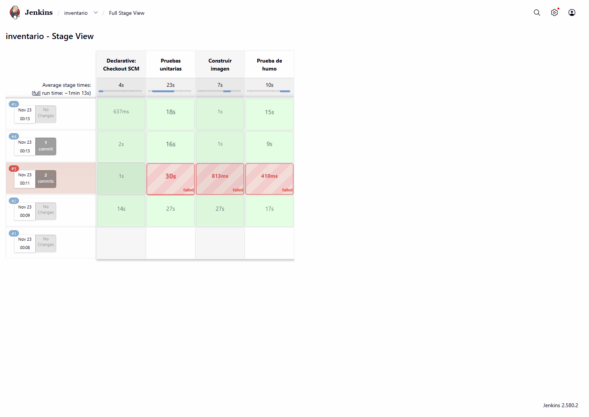

# Un pipeline, dos motores

Laboratorio de inventario del escenario 4. Jenkins y GitHub Actions verifican el mismo código Python.

## Dónde está cada pieza

El paquete, sus siete pruebas y la imagen viven en `app/`. El controlador de Jenkins se construye desde `jenkins/`.

Jenkins carga [app/Jenkinsfile](app/Jenkinsfile). GitHub descubre el flujo en [.github/workflows/ci.yml](.github/workflows/ci.yml), en la raíz del repositorio.

## Preparar el laboratorio

Usa Git y Docker con contenedores Linux. Reserva unos 4 GB de memoria y al menos 2 GB de disco. El primer build descarga imágenes y plugins.

Puedes adelantar la descarga de la imagen común con `docker pull python:3.12-slim`.

Desde `jenkins/`, copia `.env.example` a `.env` y define una clave para `estudiante`. Git ignora ese archivo.

Arranca el controlador con `docker compose up -d --build`. Sigue el inicio con `docker compose logs -f jenkins` hasta leer `Jenkins is fully up and running`.

Abre [Jenkins local](http://localhost:8080) e ingresa como `estudiante` con la clave que guardaste en `jenkins/.env`. Compose exige una clave antes de iniciar.

JCasC establece el mensaje del curso y Job DSL crea **inventario**. El job lee `app/Jenkinsfile` desde Git en la rama `main`.

Abre **inventario → Construir ahora**. La vista de etapas muestra **Pruebas unitarias**, **Construir imagen** y **Prueba de humo**.

Para usar tu copia de Git, ejecuta desde `jenkins/` el comando `docker compose -f docker-compose.yml -f compose.local.yml up -d --build`. El job construye la última revisión confirmada de `main`.

## Qué valida el pipeline

El script de pruebas crea un contenedor Python 3.12, copia la aplicación, instala pytest y arranca el proceso. Recupera el XML de JUnit antes de eliminar el contenedor.

El humo arranca la imagen y consulta `GET /salud` por HTTP dentro del contenedor. Comprueba el estado y la versión y escribe `{"estado": "ok", "version": "1.0.0"}` en la consola.

En `app/src/inventario/core.py`, cambiar la resta de `retirar` por una suma deja 11 unidades al retirar 3 de 8. La prueba `test_retirar_descuenta` espera 5. La construcción de la imagen y el humo quedan omitidos.

Restaurar `-=` recupera el descuento. Confirma la corrección, publica en `main` y vuelve a construir el job para ver los dos resultados en el historial.

Detectar la regresión antes del despliegue ayuda a reducir la tasa de fallos de los cambios (*change failure rate*). La métrica cuenta despliegues que requieren intervención en producción. Un build rojo del laboratorio no mide por sí solo esa tasa.

## Comparación de los motores

| Concepto | Jenkins | GitHub Actions |
|---|---|---|
| Archivo | `app/Jenkinsfile` | `.github/workflows/ci.yml` |
| Operación | El estudiante administra el controlador y Docker | GitHub administra el servicio y el runner hospedado |
| Pruebas | Contenedor efímero `python:3.12-slim` en Docker local | La misma imagen en el runner Ubuntu del job `pruebas` |
| Disparo | **Construir ahora** o sondeo de Git cada dos minutos | Push a `main` o ejecución manual |
| Reportes | **Test Result** del build interpreta JUnit | Artefacto **reporte-pruebas** con `junit.xml` |
| Construcción | Etapa **Construir imagen** después de pytest | Paso homónimo del job `imagen`, que depende de `pruebas` |
| Humo | Etapa **Prueba de humo** | Último paso del job `imagen` |

## Acceso al motor Docker

El socket permite que la CLI dentro del controlador cree contenedores hermanos en el motor del host. Quien puede usarlo tiene privilegios amplios sobre el host. Usa este montaje en un laboratorio local con código de confianza.

Si Linux rechaza el acceso al socket, configura `DOCKER_GID` en `.env` con el resultado de `stat -c %g /var/run/docker.sock` y recrea el controlador con Docker Compose.

Si el puerto está ocupado, cambia `JENKINS_PUERTO` en `.env`, vuelve a ejecutar Compose y abre el nuevo puerto en localhost.

## Al finalizar

Desde `jenkins/`, usa `docker compose down` para detener el servidor. El volumen conserva el historial para la siguiente clase.

## Evidencias

[Primera ejecución verde](https://github.com/mljuansmoreno/inventario-ci/actions/runs/45115847459). Los jobs de pruebas e imagen terminaron correctamente.

[Fallo controlado en Actions](https://github.com/mljuansmoreno/inventario-ci/actions/runs/45116185823), commit `77c21cb`. El JUnit registra seis aprobadas y un fallo en `test_retirar_descuenta`. Actions omitió el job `imagen`.

[Corrección en Actions](https://github.com/mljuansmoreno/inventario-ci/actions/runs/45116361574), commit `b3fee1d`. El reporte registra siete aprobadas. La imagen se construyó y superó la prueba de humo.

En Jenkins, el build **#2** completó las tres etapas. En **#3** falló la resta y quedaron omitidas las dos etapas siguientes. **#5** construyó la corrección y respondió `{"estado": "ok", "version": "1.0.0"}`.

Para revisar una ejecución, abre su sección **Artifacts**, descarga **reporte-pruebas** y abre `junit.xml`. El atributo `failures` indica cuántos casos fallaron y cada elemento `testcase` identifica la prueba.

El build **#1** se detuvo durante el checkout local por la propiedad de la carpeta Git. La excepción de confianza para `/repo-local` permitió ejecutar el pipeline desde **#2**.
